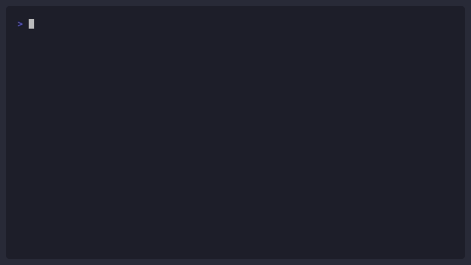

# Axiom CSC — Deterministic Circuit Breaker for AI Coding Agents


> AI agents don't fail because they write bad syntax. They fail because they **guess on ambiguous constraints.**


       [ Claude Code / AI Agent Pipeline ]
                        |
                ( PreToolUse Hook )
                        |
+───────────────────────────+───────────────────────────+
| Axiom Core Engine |
| +──────────────────────────────────────────────────+ |
| | Noema: Scope-Aware AST Lowering Pipeline | |
| +─────────────────────+────────────────────────────+ |
| | |
| +──────────────────────+───────────────────────────+ |
| | Lemma: Relational Logic Solver (<0.09ms Rust) | |
| +─────────────────────+────────────────────────────+ |
| | |
| +──────────────────────+───────────────────────────+ |
| | Manam: Tri-State Epistemic Controller | |
| +─────────────────────+────────────────────────────+ |
+────────────────────────+───────────────────────────────+
|
+───────────────────+───────────────────+
v v
[TRUE / FALSE] [UNKNOWN]
(Permit Tool Run) (Fail-Closed CLI Halt)

## Install

```bash
curl -fsSL https://raw.githubusercontent.com/axiom-csc/axiom-claude-skill/main/install.sh | bash
```

Then run zero-touch setup in your project root:

```bash
python3 .claude/skills/axiom-csc/scripts/axiom_init.py .
```

Scans your codebase — OpenAPI specs, Pydantic models, env files — and generates `.axiom/invariants.yaml` automatically.

## How it works

| Pass | Component | What it does |
|------|-----------|--------------|
| 1 | **Noema** | Extracts typed constraints from task context |
| 2 | **Lemma** | Evaluates them against your invariants (<0.1ms, deterministic) |
| 3 | **Manam** | Enforces 3-state logic: TRUE / FALSE / UNKNOWN |

**On UNKNOWN** — Claude halts and asks the exact right question.
**On FALSE** — Claude outputs an `AxiomConstraintViolation` and stops.

## Domains covered

| Domain | What Axiom catches |
|--------|-------------------|
| **Auth** | Assuming a role name implies specific permissions |
| **Payments** | Hardcoded limits that don't match your policy |
| **Rate limits** | Invented req/min values |
| **File uploads** | Assumed size caps |
| **Database** | Arbitrary LIMIT clauses |
| **API quotas** | Made-up daily call limits |
| **Timeouts** | Default timeout values pulled from nowhere |

## Demo — Auth Hallucination

**Without Axiom:**
```python
# Claude produces:
if user.role == "admin":
    return grant_full_database_access()   # invented assumption
```

**With Axiom:**
+==============================================================+
| AXIOM CSC - INVARIANT CIRCUIT BREAKER |
+==============================================================+

State: UNKNOWN
Entity: role_assignment
Rule: auth.role_permission_scope
[A] Auto-generate a secure default schema block
[I] Inject the missing value inline now
[B] Bypass this check (logged to .axiom/audit.log)
[Q] Quit and block execution

## Modes

| Mode | Trigger | Behavior |
|------|---------|----------|
| STRICT | _(default)_ | Halt on any UNKNOWN or violation |
| AUDIT | `[AXIOM: AUDIT]` | Execute + append telemetry block |
| REPAIR | `[AXIOM: REPAIR]` | Auto-rewrite violations before output |

## Custom rules

Edit `.axiom/invariants.yaml` (auto-generated by `axiom_init.py`):

```yaml
rules:
  - concept: transaction_value
    op: lte
    value: 50000
    action_on_fail: BLOCK

  - concept: role_assignment
    required: true
    action_on_missing: ASK
```

## Engine

Built by [Axiom Labs](https://github.com/axiom-csc).

## Contributing

See [CONTRIBUTING.md](CONTRIBUTING.md). Good first issues tagged on GitHub — S3 file size extractor, Kubernetes quota templates, Supabase RLS parser.

## License

MIT · [Axiom CSC](https://github.com/axiom-csc)
